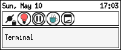
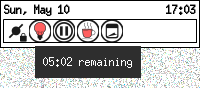
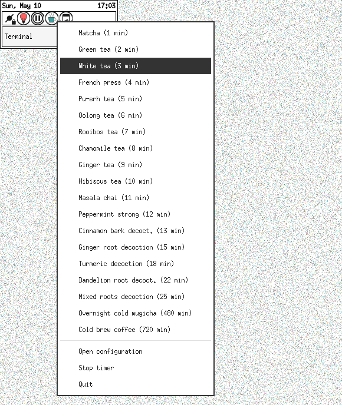

`gteatime` -- A lightweight GTK 3 system-tray tea and coffee timer
==================================================================

`gteatime` (*tea & coffee timer*) is a GTK 3 systray timer for tea and
coffee presets written in C.  The tray icon is an `XAppStatusIcon`
from `libxapp`, which works with XApp status applets and with any
`XEmbed` system tray.

   - **Last update:** Sat Nov  7 20:57:46 UTC 2026
   - **Current version:** 1.0.4

It was inspired by KDE’s classic `kteatime`, which I used in the early
2000s before moving from that desktop environment to Openbox and
a GTK3-only setup.

- Timer off and timer on icons on systray:

<!--  -->

## Dependencies

  - `libgtk-3-dev`
  - `libxapp-dev`
  - `pkgconf` (for `Makefile`)

On Debian-like systems:

    sudo apt install pkgconf libgtk-3-dev libxapp-dev

## Build

    make

## Local run

    ./bin/gteatime

## Install

Installation of the binary and the three needed icons can be done with:

    make install

By default it will be installed in `usr/local/bin`, but that can be
changed using, of course, the `PREFIX` standard.  To install it in
`/usr/bin`, use:

    make PREFIX=/usr/ install

Icons can be copied into any theme.  Under `scalable/apps` is a good
place.  For example: `~/.local/share/icons/my_icon_theme/scalable/apps/`.
There are only three icons:

  - `gteatime.svg`  -- program icon
  - `gteatime-on.svg` -- systray running icon
  - `gteatime-off.svg` -- systray idle icon

Although, the "on" and "off" icons are for the systray, and maybe it
will be better to put them in the directory `scalable/status`.

## Uninstall

    make uninstall

But if the program was installed by modifying the `PREFIX` directory, it
has to be specified as well, and in the same way, when invoking
`uninstall`.

## Desktop support

This program requires either an XApp status applet (Cinnamon, MATE,
Xfce) or an X11 tray manager that owns `_NET_SYSTEM_TRAY_Sn` (where *n*
is the X11 screen number), such as the system tray of most X11 panels.
KDE Plasma shows `XEmbed` icons through its own proxy.  GNOME on
Wayland normally requires a tray extension.

## Behavior

- Left and right click on the tray item open the preset menu.
- The tray icon shows whether a timer is running or idle.
- A D-Bus desktop notification is shown when the timer completes.

## Style notes

The code is written as C99-compliant.

Most editable program constants, including icon names and user-visible
identity strings, are in `include/defs.h`.

## Author

  - J. A. Corbal <jacorbal@gmail.com>
